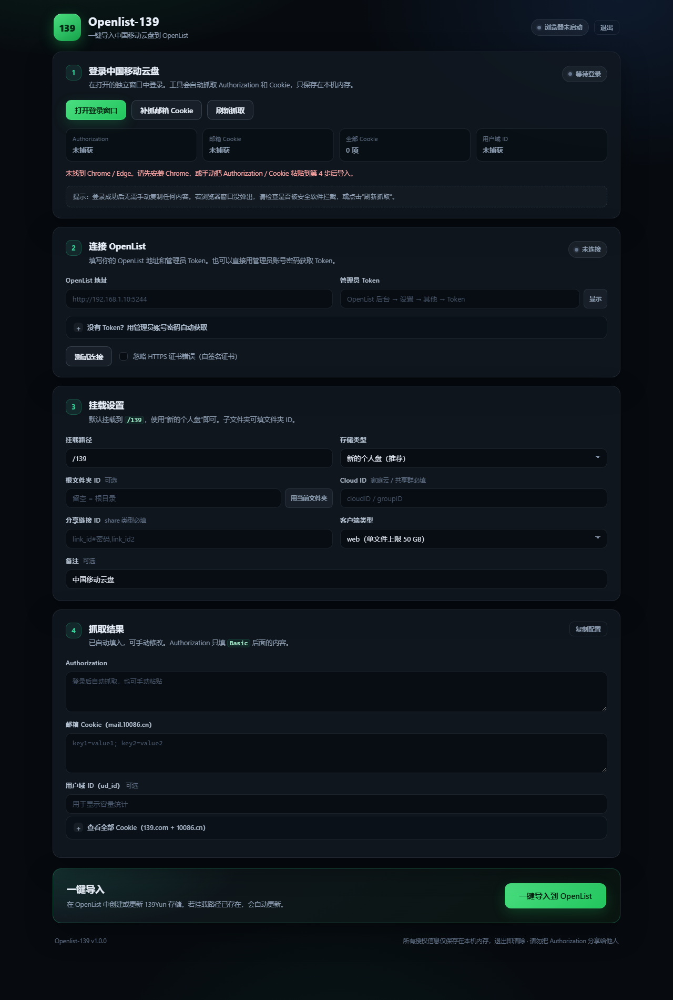

# Openlist-139

[](https://github.com/Zyqwq2015/Openlist-139/actions/workflows/build.yml)
[](LICENSE)
[](https://github.com/Zyqwq2015/Openlist-139/releases/latest)

把中国移动云盘（139 云盘）一键挂载到 [OpenList](https://github.com/OpenListTeam/OpenList) 的小工具。

打开工具后，在独立浏览器窗口里登录移动云盘，工具会自动抓取 `Authorization`、Cookie 等信息，然后直接调用 OpenList 管理 API 创建或更新 `139Yun` 存储。全程中文界面，不需要手动复制 Token、Cookie 或拼接 JSON。



---

## 功能

- 一键打开独立浏览器窗口登录中国移动云盘（不影响你日常使用的 Chrome/Edge 配置）。
- 自动抓取：
  - `Authorization`（自动去掉 `Basic ` 前缀，直接写入 OpenList）
  - 139 邮箱 Cookie（`mail_cookies`）
  - 全部 `139.com` / `10086.cn` Cookie
  - 用户域 ID（`ud_id`，用于容量统计）
- 支持用管理员账号密码自动获取 OpenList Token（可填两步验证码）。
- 一键测试 OpenList 连接并检查 `139Yun` 驱动是否存在。
- 一键创建存储；如果挂载路径已存在，自动改为更新，不会重复创建。
- 支持新的个人盘、旧版个人云、家庭云、共享群、分享挂载五种类型。
- 所有授权信息只保存在本机内存，工具退出即清除；不会上传到任何第三方服务器。

## 使用要求

- Windows 10 / 11（自带 .NET Framework 4.x）。
- 本机安装 Chrome 或 Edge（用于打开登录窗口）。没有浏览器也可以手动粘贴 Authorization / Cookie。
- OpenList **v4.2.4 或更高版本**，且已包含 `139Yun` 驱动。
- OpenList 管理员 Token（或管理员账号密码）。

## 快速开始

1. 从 [Releases](https://github.com/Zyqwq2015/Openlist-139/releases/latest) 下载最新版 `Openlist-139.exe`，或直接使用仓库中的成品，双击 `Openlist-139.exe`（或 `启动 Openlist-139.cmd`）启动。
2. 工具会自动打开控制面板和登录窗口。若控制面板没有自动弹出，双击 `%LOCALAPPDATA%\Openlist-139\port.txt` 里的端口访问，或重新运行程序。
3. **第 1 步：登录中国移动云盘**
   - 在打开的浏览器窗口里用手机号 / 密码 / 短信验证码登录。
   - 登录成功并进入网盘页面后，控制面板会显示 `Authorization 已捕获`、Cookie 数量等信息。
   - 如果只使用邮箱 Cookie 登录，可点“补抓邮箱 Cookie”再登录 139 邮箱。
   - 没抓到时点“刷新抓取”。
4. **第 2 步：连接 OpenList**
   - 填写 OpenList 地址，例如 `http://192.168.1.10:5244`。
   - 填写管理员 Token：OpenList 后台 → 设置 → 其他 → Token。
   - 没有 Token 时，展开“没有 Token？用管理员账号密码自动获取”，填写用户名、密码（和两步验证码），点“获取 Token”。
   - 点“测试连接”，确认显示“139Yun 驱动可用”。
   - 如果 OpenList 使用自签名 HTTPS 证书，勾选“忽略 HTTPS 证书错误”。
5. **第 3 步：挂载设置**
   - 挂载路径默认 `/139`，可改成 `/移动云盘` 等。
   - 存储类型默认“新的个人盘”，一般无需修改。
   - 需要挂载某个子文件夹时填写“根文件夹 ID”，或登录后在网盘里打开该文件夹，再点“用当前文件夹”。
   - 家庭云 / 共享群需要填 Cloud ID；分享挂载需要填分享链接 ID。
6. **第 4 步：一键导入**
   - 确认抓取结果后，点最下方的“一键导入到 OpenList”。
   - 成功后会显示存储编号、状态和挂载路径；回到 OpenList 首页即可看到新目录。
   - 如果提示“挂载路径已存在”，工具会自动更新原存储，不会新建重复项。

## 命令行参数

```text
Openlist-139.exe                 正常启动（自动打开控制面板和登录窗口）
Openlist-139.exe --no-browser    只启动本地服务，不自动打开浏览器
Openlist-139.exe --port=53139    指定控制面板端口（默认 53139，被占用时自动顺延）
```

## 文件与日志

| 内容 | 位置 |
| --- | --- |
| 程序 | `Openlist-139.exe` |
| 控制面板端口 | `%LOCALAPPDATA%\Openlist-139\port.txt` |
| 运行日志 | `%LOCALAPPDATA%\Openlist-139\app.log` |
| 登录浏览器配置 | `%LOCALAPPDATA%\Openlist-139\browser-profile\` |

登录浏览器使用独立配置目录，登录状态会在本机保留，方便下次直接抓取。想彻底清空登录状态，退出工具后删除 `browser-profile` 文件夹即可。

## 安全说明

- `Authorization`、邮箱 Cookie、OpenList 密码和 Token 只在内存中处理，不做持久化保存。
- 控制面板只监听 `127.0.0.1`，不对局域网开放。
- 浏览器只保存你填写的 OpenList 地址、挂载路径、用户名等非敏感偏好到 `localStorage`。
- 不要把抓到的 `Authorization` 或 Cookie 发给他人，它等同于你的云盘登录凭证。
- 如果不再使用，建议在移动云盘里退出登录，或在 OpenList 中删除对应存储。

## 常见问题

**没有弹出登录窗口 / 提示找不到浏览器**

安装 Chrome 或 Edge 后重试。也可以点“补抓邮箱 Cookie”或直接在“抓取结果”里手动粘贴 Authorization 和 Cookie。

**登录了但 Authorization 仍是“未捕获”**

在登录窗口里进入网盘文件列表并随便打开一个文件夹，让页面发出带 `Authorization` 的请求，然后点“刷新抓取”。仍不行时可手动粘贴：在登录窗口按 F12 → Network，找到 `yun.139.com` 的请求，复制请求头里 `Authorization: Basic` 后面的内容。

**提示“未找到 139Yun 驱动”**

当前 OpenList 版本太旧，升级到 v4.2.4 或更高版本，确认 `139Yun` 驱动存在后重试。

**提示“管理员 Token 无效或已过期”**

重新在 OpenList 后台复制 Token，或展开账号密码区域重新获取 Token。

**导入后状态不是 work**

通常是授权信息失效或根文件夹 ID 不对。重新登录移动云盘抓取一次，确认根文件夹 ID 后再次导入（会更新原存储）。也可在 OpenList 后台点“重新加载”查看具体报错。

**控制面板端口被占用**

工具会自动换端口，实际端口见 `%LOCALAPPDATA%\Openlist-139\port.txt`；也可以用 `--port=` 指定。

## 从源码构建

需要 Windows 自带的 .NET Framework 4.x 编译器，无需安装 .NET SDK、Node.js 或 Python。

```powershell
powershell -ExecutionPolicy Bypass -File .\build.ps1
```

构建脚本会调用系统 `csc.exe`，把 `src/web` 下的页面嵌入 `Openlist-139.exe`。修改前端或 `src/Program.cs` 后重新运行即可。

## 目录结构

```text
Openlist-139/
├─ Openlist-139.exe       编译好的成品
├─ 启动 Openlist-139.cmd  双击启动
├─ build.ps1              构建脚本
├─ README.md
└─ src/
   ├─ Program.cs          本地 HTTP 服务、Chrome/CDP 抓取、OpenList API
   └─ web/
      ├─ index.html       控制面板
      ├─ app.js           前端交互
      └─ style.css        样式
```

## 开源协议

本项目以 [GNU General Public License v3.0](LICENSE) 开源。你可以自由使用、修改和分发，但分发修改后的版本时需同样以 GPL-3.0 开源，并保留版权与许可证声明。

## 参与贡献

欢迎提交 Issue 和 Pull Request。提交前请确认：

- 不包含任何真实的 Authorization、Cookie、Token 或账号密码。
- 修改后至少运行一次 `build.ps1`，确保能正常编译。
- 前端改动请在 Chrome / Edge 中实际点一遍完整流程。

## 说明

本工具通过 OpenList 官方管理 API 写入存储配置，不修改 OpenList 程序文件。OpenList 与 139Yun 驱动的行为可能随版本变化，建议保持 OpenList 为较新版本。请仅用于管理自己的账号与云盘。
